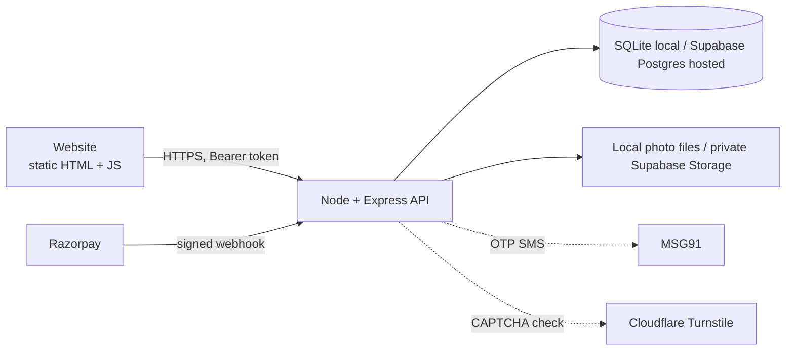

# va_ca

**A verified matching app for businesses and influencers.** Businesses like creators, creators pay once to unlock their likes after a 7-day hold, and a mutual like opens a chat.

> **Status: working prototype / portfolio project. Not live, no real users, no real payments.**
> Built with AI assistance (Claude). The SMS, CAPTCHA and payment adapters follow the providers' documented formats but have **not** been tested against the live services.
> The brand name "va_ca" is a placeholder.

[Live demo](https://claude.ai/artifact/TELhmJfrrGvDp3GACsJ6dd) (demo mode, no backend; the OTP is shown on screen) · [Case study](docs/CASE_STUDY.md) · [Go-live checklist](docs/SETUP.md)

<!-- After you add screenshots (see docs/SCREENSHOTS.md), remove this comment and add:
| Log in / Sign up | Discover | Chat | Payment |
|---|---|---|---|
|  |  |  |  |
-->

## How it works
1. A business signs up with mobile OTP (or password) and its GSTIN. An admin approves it.
2. Approved businesses browse verified influencers and send likes.
3. An influencer pays once. The **server** starts a 7-day timer. Until it ends, the influencer's app receives nothing about who liked them (not even a count).
4. After 7 days the likes are revealed. A like back opens a chat for both sides.

## Architecture

Stack: Node 22, Express, SQLite for local tests, optional Supabase Postgres and private Storage for hosting, sharp, and plain HTML/CSS/JS for the website. Two modes: **demo** (no backend, everything simulated) and **live** (talks to the API).

## Security work (the main point of this project)
| Risk | What the server does | Test |
|---|---|---|
| Fake "I paid" | Only a **signed webhook** can mark a payment paid. Wrong signature, wrong amount, stale or repeated events are rejected. | `test.js` 1 |
| Breaking the 7-day hold | Server clock only. Locked responses contain no like data. Phone clock and headers are ignored. | `test.js` 2 |
| Reading other people's data | The user comes from the session token, never from the request. Every chat, photo and payment is checked per object. | `test.js` 3 |
| Fake verified profiles | GSTIN format + checksum, admin approval required for every action. | `test.js` 4 |
| OTP abuse | Hashed, 5-minute expiry, 5 tries, single use, 30 s cooldown, hourly caps, CAPTCHA. | `test.js` 5 |
| Dangerous uploads | Real file-type check, 5 MB cap, re-encoded to WebP (removes EXIF/GPS), random names, admin or hook moderation. | `test.js` 6 |
| Chat spam and scams | Length limits, link flags, rate limit, block, report, plain-text rendering. | `test.js` 7 |
| Scraping | Login required, 20 per page, rate limits, random IDs. | `test.js` 8 |
| Account theft | 15-minute access tokens, rotating refresh tokens with reuse detection, log out everywhere, scrypt passwords. | `test.js` 9, 9b |
| Privacy | Versioned consent, data export, account deletion that erases personal data. | `test.js` 10 |

Details and one real bug the end-to-end test caught: [docs/CASE_STUDY.md](docs/CASE_STUDY.md).

## Run it
```bash
npm install
npm test          # 20 security tests (API, adapters, storage)
npm run e2e       # 14-step journey: real website <-> real API, two users
# dev server (OTP is printed in the terminal, no SMS is sent):
SECRET="$(openssl rand -hex 24)" WEBHOOK_SECRET="$(openssl rand -hex 12)" node index.js
```
Open `frontend/index.html` for demo mode. For live mode build the site with `node frontend/build.js --api http://localhost:3000`.

## Production-ready hosting path
This prototype is already working locally, and the fastest next step is to move it into a hosted stack without breaking the demo flow.

### Supabase + Render Free hosting
The API can use Supabase Postgres and a private Supabase Storage bucket for hosted data and photos. Render Free runs the Node API from the root `Dockerfile`, but sleeps when idle and has an ephemeral filesystem; persistent app data therefore stays in Supabase. Set the required variables from `.env.example` in Render and use the Supabase Session Pooler connection string.

Supabase Free currently includes 500 MB of database and 1 GB of file storage, and can pause projects after a week of inactivity. Render Free can take about a minute to wake after sleeping. These limits make this suitable for a demo, not a production launch. Keep `frontend/index.html` in demo mode; build and host a separate live frontend only after the API and provider tests pass.

## Not built yet
Photo sharing inside chat, block/report buttons in the website (the API has them), email / Google / Apple login, password reset, refunds, notifications. Rate limits are in memory, so run a single API instance. Supporting multiple replicas requires implementing shared rate limits.

## Disclaimer
Charging influencers to see likes, handling money between users, and storing personal data all have legal rules (payment-aggregator rules, DPDP Act consent). Get advice from a lawyer or CA before launching for real. No license is attached yet; choose one before making the repo public.
